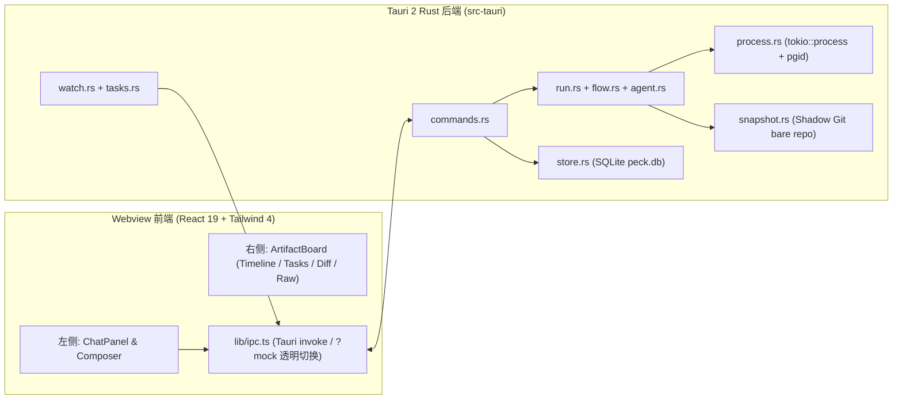

# Peck 架构设计与影子 Git 规范 (Architecture)

## 1. 总体架构

---

## 2. 影子 Git 快照机制 (Shadow Git)

为了在不触碰用户工作区 `.git/index`、不产生任何临时 Commit 或 Stash 的前提下精确计算每一步的文件增删改 Diff，Peck 采用独立的裸仓库快照方案：

1. **存储路径**：
   - `~/Library/Application Support/Peck/shadow/<workspace_md5>/`
   - 初始化命令：`git init --bare`
2. **快照生成 (`write-tree`)**：
   - 注入环境变量 `GIT_DIR=<shadow_path>` 与 `GIT_WORK_TREE=<workspace_path>`。
   - 强制追踪 `.peck/` 目录与工作区非忽略文件，执行底层 plumbing 命令生成 tree hash：
     - `git add -A`
     - `git write-tree`
     - `git commit-tree <tree_id> -m "snapshot"`
3. **步骤级 Diff 计算**：
   - Step $k$ 启动前记录快照 $S_{k-1}$，结束后记录快照 $S_k$。
   - 调用 `git diff <S_{k-1}> <S_k>` 获取标准 Unified Diff 文本，供前端 `DiffView` 解析染色。

---

## 3. 前后端通信契约

- **请求-响应 (`invoke`)**：由 `src/lib/ipc.ts` 统一封装 10 个命令（`workspace_open`, `workspace_list_recent`, `session_create`, `session_list`, `session_get_messages`, `run_dispatch`, `run_cancel`, `run_retry_step`, `changes_get_diff`, `agents_list`）。
- **流式事件 (`Channel<RunEvent>`)**：`run_dispatch` 与 `run_retry_step` 接收事件回调，实时推送 `RunStarted`、`StepStarted`、`StepOutput`、`TasksUpdated`、`FileTouched`、`StepFinished`、`RunFinished`。
- **浏览器 `?mock` 降级**：当 URL 带有 `?mock` 参数或不在 Tauri Webview 容器内时，`src/lib/ipc.ts` 自动路由至 `src/dev/mockIpc.ts`。
