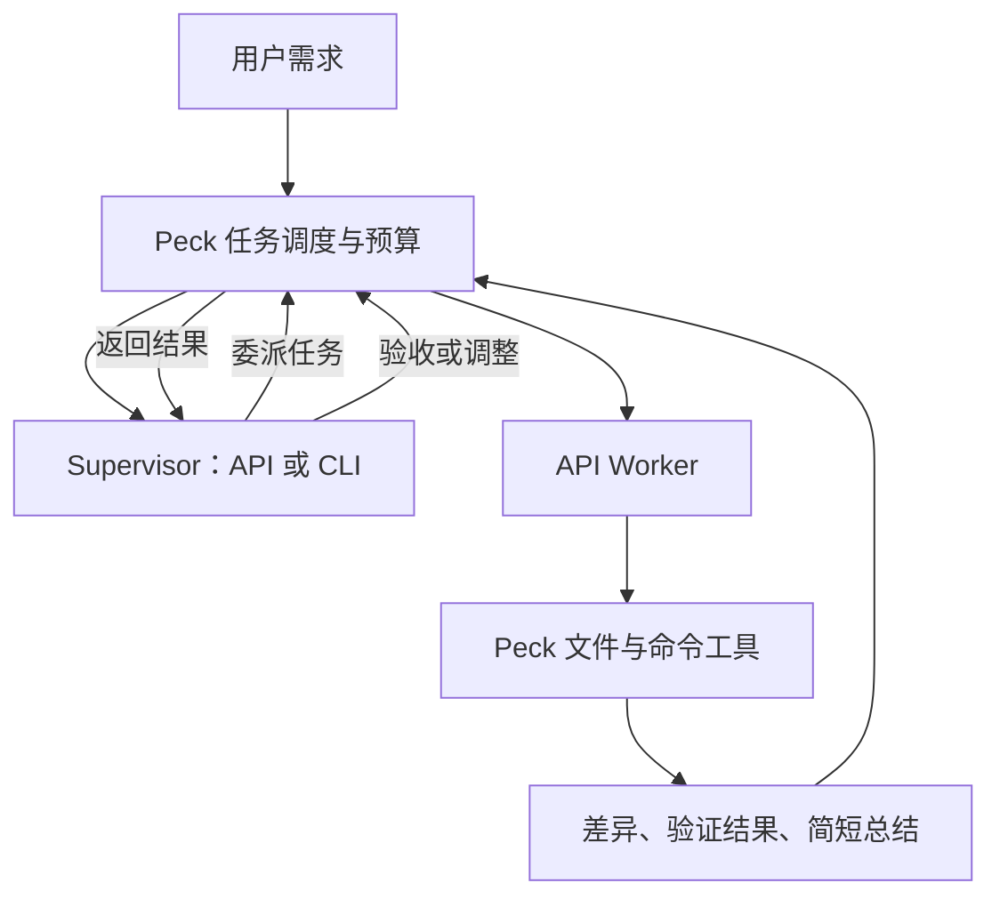

# Peck v0.2 — API Supervisor / Worker 架构建议

日期：2026-11-06。状态：**设计草案，尚未实现**。v0.1 按用户要求暂停，待订阅 Grok / Muse 后继续真实接入验收；本轮不修改运行时代码。

## 1. 用户目标与建议边界

用户目标：接入多家模型 API；区分 Supervisor 与 Worker；配置 API Key、模型、思考能力与强度；允许 Grok / Muse CLI 委派 API Worker。

建议将 v0.2 做成由 Peck 管理的本地开发 Agent 系统：Supervisor 做规划、分工、验收与必要的复杂实施，Worker 执行边界明确的任务。API 与 CLI 共用任务记录、预算和文件看板。

Supervisor / Worker 是 **Agent 的角色**，不要永久绑定为模型档次。默认可以选择 Opus 5.5 担任 Supervisor、DeepSeek Flash 担任 Worker，但同一模型可配置成不同角色；价格不等于某次任务的成功率。简单任务可直接使用 Worker，复杂任务才启用 Supervisor 协作。

v0.2 不依赖 Grok / Muse 订阅；先用 API 路线完成闭环，CLI 委派作为后续兼容入口。真实 API 联调需要相应渠道的有效访问条件，本轮不索取 Key、不调用模型。

## 2. 推荐结构

保留 Tauri + React + Rust + SQLite，直接扩展现有 Rust 后端；初版不引入另一个常驻服务或多套 Agent 框架。

- **模型负责判断**：规划、选择工具、提出委派、审查结果。
- **Peck 负责执行与状态**：处理工具调用、调度 Worker、执行本地操作、管理写入顺序、预算、取消和历史。
- **文件保存交付物**：继续使用规范、任务清单、源码与 Diff；API 对话、工具调用和模型使用量保存在 SQLite，不强行把所有通信转成文件。

API 返回文本或工具调用，不会自动在本机开发。Peck 必须实现“请求模型 → 接收工具调用 → 执行工具 → 回传结果 → 继续请求”的循环。这是 v0.2 的核心新增能力，见 [Claude 工具说明](https://platform.claude.com/docs/en/agents-and-tools/tool-use/overview)及 [DeepSeek 工具说明](https://api-docs.deepseek.com/guides/tool_calls/)。

## 3. 配置分开管理

| 配置 | 保存内容 | 示例 |
|---|---|---|
| Provider | 名称、端点、API 协议、Key 的引用 | Anthropic 直连、DeepSeek 直连、自定义兼容端点 |
| Model profile | 模型 ID、能力、默认思考设置、输出上限 | Opus 5.5 / DeepSeek Flash 的配置 |
| Agent profile | Supervisor 或 Worker、使用的模型配置、可用工具 | 架构负责人、实现 Worker |
| Run / Task | 本次目标、父任务、实际模型设置、状态、使用量 | 同一需求下的一项实现任务 |

API Key 存 macOS Keychain；SQLite / TOML 仅保存引用，日志不记录完整密钥。React 只提交设置给 Rust，由后端完成请求，不让 Key 随普通前端配置流转。

同一供应商可配置多个端点或账户。能力按“端点 + 协议 + 模型”识别，不只依赖模型显示名。首次接入支持加载模型列表；没有完整能力元数据的渠道允许手动填写模型 ID，并使用已验证的能力配置，不能假设 `/models` 返回全部思考与工具信息。

首批做两条实际协议路径：Anthropic Messages 与 Chat Completions，分别验证用户举例的 Claude 和 DeepSeek。后续按真实需求加入 Responses、Gemini 等适配；不承诺仅改 base URL 就兼容所有厂商。

## 4. 思考设置按模型能力展示

建议能力配置至少包含：是否支持工具调用、流式输出、思考模式类型、能否关闭思考、可用强度档位。界面仅提供实际支持的选项；模型配置保存默认值，任务允许本次覆盖，并在运行历史中记录每次调用最终生效的值。正在流式生成的请求不在中途更改参数。

截至本次官方文档核对：

| 模型 | 思考设置 | 强度选项 |
|---|---|---|
| Claude Opus 5.5 | 始终启用 adaptive thinking，不支持关闭 | low / medium / high / xhigh / max |
| DeepSeek Flash | 支持开关 | low / high / max |

[Opus 5.5 官方迁移说明](https://platform.claude.com/docs/en/models/opus-5-5/migration-guide)指出，关闭思考或使用手动 thinking token budget 会被拒绝，强制指定工具调用也不受支持。不能为该模型展示可操作的“关闭思考”开关，也不能要求它使用强制 tool choice 来完成委派。

[DeepSeek 思考说明](https://api-docs.deepseek.com/guides/thinking_mode/)列出了开关、档位和不同协议的映射；[模型列表说明](https://api-docs.deepseek.com/api/list-models/)提供了能力元数据的示例。模型升级或换渠道时应重新核对，不把本次档位永久写死在界面中。

工具循环需要保留供应商要求回传的原始消息块、工具 ID 和思考/签名块；适配器不能只抽取文本后丢弃其他信息。跨模型委派仅传任务、必要证据和结果摘要，不转发整段内部思考。界面展示 API 实际提供的可见思考摘要或状态，不伪造完整思考过程。

## 5. 最小可用的开发闭环

1. 用户选择单 Worker，或 Supervisor + Worker；配置本次工作区和预算。
2. Supervisor 通过读取与搜索工具了解项目，形成简短方案和验收条件。
3. Supervisor 调用 `delegate_task`，指定目标、必要上下文、相关文件范围与验证要求。模型提出委派，Peck 创建该 Run 下的子任务。
4. Worker 在限定的任务上下文中读取、搜索、应用补丁和执行命令；验证过程与结果保留在任务历史中。
5. Peck 通过现有文件监听和影子 Git 取得真实改动，返回变动文件、Diff 引用、命令退出状态、失败摘要与使用量。
6. Supervisor 判断完成、返工或亲自处理复杂部分，达到验收条件后汇报。

首批工具只做读取文件、列目录/搜索、应用补丁、执行命令，以及 Supervisor 使用的委派工具。API 模型不能直接执行本机操作，实际操作由 Peck 的工具执行层完成。

Worker 默认不再委派下一层 Worker。先限制为一个 Supervisor 和一层 Worker，跑通实际开发流程后再评估更深的协作需求。

Supervisor 亲自实施复杂任务时，也使用同一工具层和写入队列，不另造执行体系。简单任务允许跳过 Supervisor，避免为小改动支付多次高价审查成本。

## 6. 调度与并发

现有 `run.rs` 是固定顺序 Flow，不是 API Agent 循环。现有 `commands.rs` 对同一工作区限制一个活动 Run；影子 Git 也使用该工作区的独立快照索引。因此子 Worker 不能直接再次调用根级 `run_dispatch`，更不能先移除限制让多个 Worker 同时改目录。

建议保留“一次用户请求对应一个根 Run”，内部用父子 Task / Step 表示委派。先串行写入工作区；并行能力优先用于互不修改文件的读取与分析。需要多人同时改代码时，再增加隔离工作区与变更合并，而不是在 v0.2 首个闭环里引入完整 worktree 编排。

父任务取消时停止创建新子任务，取消活跃 API 请求和进程；进程重启后读取已记录的状态，明确标记中断。对可能已产生远端结果的请求不静默重放，以免重复费用或文件操作。

## 7. Grok / Muse CLI 如何调用 Worker

建议提供一个由 Peck 实现的 MCP Worker 入口，向 CLI 暴露“委派任务、查询任务、取消任务”等工具；长任务返回任务 ID，避免必须阻塞到客户端工具超时。API Supervisor 的函数调用与 CLI 的 MCP 工具最终调用同一个任务调度器和 Worker Runner。

[Grok MCP 文档](https://docs.x.ai/build/features/mcp-servers)和 [Muse MCP 文档](https://dev.meta.ai/docs/muse-code/extending)均说明了外部工具接入，并提供本地 stdio 或 HTTP 类传输能力。这是接口可行性的依据，尚不等于已经验收真实 CLI。

建议在 CLI 兼容阶段才启动本机 MCP 入口，运行于现有 Rust 应用内、仅监听回环地址，并使用绑定当前 Run 的访问凭据。CLI 取得委派能力即可，供应商 API Key 仍由 Peck 保管；配置方式需按实际 CLI 版本联调，不提前修改用户全局配置。

初版 CLI 路线优先委派只读调查、代码审查和补丁生成，由 CLI 自己统一应用补丁和运行项目验证。原因是外部 CLI 原生的文件操作不会自动受到 Peck 写入队列约束，不能声称 Peck 能阻止其与 Worker 同时写文件。后续若要让该路线的 Worker 直接写入，需要验证 CLI 的写工具限制或提供隔离执行目录。

这会减少 CLI 自己完成具体子任务的工作量，但 CLI 仍会消耗上下文与调度额度；是否节省需要看整次任务的总成本和成功率，不能承诺所有任务都更便宜。

## 8. 费用与上下文

- 每个 Worker 只收到相关文件和明确验收条件，不默认复制 Supervisor 全部对话；返回摘要、产物引用和验证结果，而不是完整日志反复传回。
- 保存每次模型调用的输入/输出/缓存 token 用量（供应商返回时）、模型设置、耗时和结果；按 Supervisor / Worker / Run 汇总。
- CLI 主进程没有报告的 token 或费用标记为未知，不填成 0；API Worker 费用单独记录，不将其与订阅额度做未经验证的折算。
- 单任务限制模型轮数、最大输出、重试次数；整次 Run 设置预算，并在达到阈值时暂停调度。费用显示区分预估与实际可核对的使用量，不把本地估算当供应商账单。
- Worker 失败先返回具体证据，再按有限次数返工或升级给 Supervisor，避免无限“继续尝试”。

便宜模型、低思考强度与多 Worker 都不自动等于总成本低。上下文大小、返工次数和 Supervisor 审查频率同样重要。第一版以可解释的单 Worker 直达与 Supervisor 协作为基础，复杂自动路由后置。

## 9. 复用与必要调整

| 现有部分 | v0.2 处理 |
|---|---|
| Tauri / React 界面、IPC | 复用，增加 API 配置与角色选择 |
| 步骤时间线、任务清单、文件 Diff | 复用，显示父子任务、模型与使用量 |
| 工作区监听、影子 Git | 保留，纳入统一写入顺序 |
| SQLite 历史 | 保留原数据；以版本化迁移增加父任务、角色、实际配置和模型调用记录 |
| CLI 清单与进程控制 | 保留为 CLI 执行入口，不把 API 模型硬塞成命令行进程 |
| 顺序 Flow / 执行状态 | 扩展根 Run 内的任务调度，补充真正的 API 工具循环 |
| v0.1 的模拟降级 | 仅用于明确选择的演示；API 认证/额度失败不得悄悄模拟成成功 |

v0.1 的“以文件完成 CLI 交接”适用于保留的 CLI 路线；v0.2 新增 API 对话与工具调用后，需要在正式实现时同步更新旧架构说明，避免旧边界与新能力冲突。

## 10. 建议实施顺序与完成标准

| 阶段 | 实施内容 | 通过标准 |
|---|---|---|
| A：API 基础 | Provider / Keychain、模型配置、流式输出、能力对应的思考选项 | 一个真实 API 可调用、取消并记录设置与使用量；不支持的参数不可选 |
| B：单 Worker 开发 | 本地工具循环、文件/命令执行、真实 Diff、历史恢复 | Worker 能完成一个小型真实代码修改，运行相称验证并留下可检查产物 |
| C：Supervisor 协作 | 委派工具、父子任务、结果审查、有限返工与预算 | Supervisor 能委派给另一个模型、审查结果并在失败或超预算时正确停止 |
| D：多供应商完善 | 验证 Anthropic 与 DeepSeek 的双模型组合，加入后续有实际需求的渠道 | 保留原始工具上下文，正确适配不同思考档位，记录每次实际模型设置 |
| E：CLI 委派兼容 | 本机 MCP Worker 入口、CLI 专用配置与端到端验收 | Grok、Muse 分别可调用 Worker，任务与费用归入 Peck 历史 |

阶段 A/B 优先以 DeepSeek Flash 跑通一个可独立开发的 Worker；随后接入 Opus 5.5 Supervisor 完成跨模型协作。阶段 E 取决于 CLI 可用条件，不能阻塞 API 路线。

本轮只完成源码核对、官方接口调研与方案记录。后续开发时按阶段验收，不提前承诺未测试的服务兼容性、节省比例或 CLI 委派效果。
